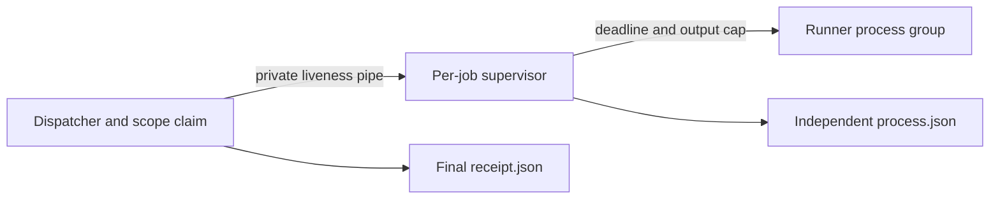

# Bounded build agents

Reusable components for coordinating coding agents over an existing task tracker. DIMAGGI AI builds vertically integrated AI infrastructure, software and products; research, economic analysis and services support that product system.

This package adds a small orchestration boundary to governed-autonomy. It does not replace the promotion gate, Tool Guard, workload allocation, metering, TENWA execution authority or a task tracker. It creates no daemon, cloud account, repository or paid service.

## What runs

- `agent_adapters.py`: generates matching Codex and Claude role definitions from one reviewed manifest. Models and permissions remain inherited. Existing different files are refused, not overwritten.
- `scripts/agent_supervisor.py`: one short-lived child per dispatch, owning the runner process group, deadline and bounded log even if the dispatcher exits. Keep it beside `agent_dispatch.py`; it is not a daemon.
- `scripts/agent_dispatch.py`: validates an explicit tracker work packet against a trusted repository allowlist and clean pinned checkout. Default is a plan. `--execute` runs an installed CLI, with a cooperative scope claim, wall-clock timeout, capped output and a result receipt.
- `scripts/agent_evidence.py`: validates delivery evidence, calculates cost per accepted outcome and matched baseline cost-saving ROI, measures data-governance coverage, and screens improvement candidates for independent review.
- `scripts/agent_profile_contract.py`: checks a public/synthetic **inference** fixture contract. It binds provenance, exact workload/SLO configuration, measured portability evidence, network measurement configuration and distinct supply states. It does not calculate infrastructure performance or establish hardware qualification.

Python 3.11+, standard library only. Dispatch requires a POSIX host and installed authenticated Codex or Claude CLI. Tests use fake runners, not paid model calls. Existing repository promotion-gate tests retain their own dependencies.

```sh
python3 -m unittest discover -s tools/build_agents/tests -v
python3 tools/build_agents/scripts/agent_profile_contract.py \
  tools/build_agents/config/agent-profile-fixtures.json --as-of 2026-10-21
```

The fixture is authored synthetic evidence plus an official public reference, not a live GPU/TPU measurement. Its dates are fixed for reproducible regression; a future freshness review must use the actual review date and renew evidence deliberately.

## Dispatch contract

An `agent-work-packet/v1` packet has exactly: `schema`, `issue_url`, `execution_block`, `tool`, `repository`, `base_sha`, `branch`, `paths`, `reviewer`, `timebox_seconds`, `max_output_bytes`, `task`.

`tool` and `reviewer` are different members of `codex|claude-code`. The caller obtains a current authenticated issue snapshot; the adapter cannot authenticate a pasted JSON document. Keep the existing task metadata schema unchanged. The issue's plain-text Execution block contains these lines (the owned-path list uses compact JSON and must match packet order exactly):

```text
Execution:
Implementer: codex
Repository: example/project
Base SHA: <40 lowercase hex characters>
Branch: codex/42-bounded-change
Owned paths: ["src/component","tests/component"]
Cross-reviewer: claude-code
Timebox seconds: 120
Output budget bytes: 1048576
```

Optional `Model`, `Session`, `Last checked`, `Handoff` lines are preserved as context, never authorization. `task` travels on stdin, never through shell interpolation. Repository identity, branch and HEAD must match and the checkout must be clean. Checkouts with submodule gitlinks are refused; use standalone checkouts. Git status disables executable clean/process filters for that invocation only, so filtered worktrees may be conservatively reported dirty. The trusted root must contain the isolated checkout as a child. Plan example:

```sh
python3 tools/build_agents/scripts/agent_dispatch.py \
  --packet /trusted/task.json --trusted-root /trusted/worktrees \
  --checkout /trusted/worktrees/task-42 --tracker-repository example/tasks \
  --allow-repository example/project
```

Add `--execute` only for the currently authorized task. Default CLI safeguards remain; the adapter sets no bypass flag. Missing permission is a blocked action, not a reason to weaken controls. Remote pushes are not checked by this local receipt; enforce remote-write permissions separately. The adapter's builder prompt excludes push/merge/deploy; delivery through an authorized branch/PR is the coordinator's separate, reviewed step. `completed_pending_review` means the process exited successfully and visible scope/identity checks passed, not that the task is correct, accepted or released.

## Security and operational limits

The execution host is part of the trust boundary. Input allowlists, tracker observations and CLI binaries must be supplied by a trusted operator, not by a candidate repository. Agent-generated files and retrieved web content are untrusted data. Scope claims serialize cooperating processes sharing one host/root. They are not distributed locks: use the existing centralized workflow's concurrency and tracker assignment before dispatching across hosts. A crashed claim is investigated; elapsed time never grants takeover.

Path restrictions are prompt constraints plus Git-visible post-run detection, **not filesystem containment**. Ignored files, transient edits and external effects are outside that check. Use independently enforced sandbox/tool/egress policy for those boundaries. An agent running as the user's UID is not hostile-agent isolation. The adapter enforces wall time and captured output, **not token or dollar spending caps**. Same-host receipts and caller-supplied evidence are not cryptographically authenticated. Do not auto-retry an uncertain external outcome.

### Interrupted jobs and claim reconciliation



SIGINT, SIGTERM and SIGHUP request termination of the runner's **original
process group** through the supervisor. The failed receipt names the dispatcher
interruption; `process.supervisor_reason` preserves a different original reason,
such as a deadline that expired before the interruption. `supervisor-start.json`
records `running`, runner/session/group IDs and UID; it is not cleanup proof.

A claim is released only when the supervisor confirms that no non-zombie member
of the original group or same-UID process in the original runner session remains.
A child using `setpgid` can escape the original group's kill but remains visible
in that session: it keeps ownership until separately reconciled. The supervisor
**does not signal another group or escaped session**. Unsupported, denied,
malformed or timed-out process inspection is uncertain and retains the claim.
The observation uses `ps` columns `pid,pgid,uid,stat` and
`getsid`; it is not a portable guarantee for every POSIX host. A disappearing
same-UID row invalidates that snapshot because it may have forked an unseen
child; the next scan retries. Only the exact launched observer PID is ignored. Every exception after entering `Popen`, including `OSError` or
`FileNotFoundError`, leaves `launch_uncertain: true` and retains the claim. An
exception class does not establish that a forked child was reaped. Even a missing
executable can therefore require reconciliation; there is no automatic retry.

Runner termination happens before selector/control-descriptor cleanup. Close
failures are retained in `cleanup_errors` and do not prevent the process receipt.
An unavailable receipt still retains ownership. Cleanup allows up to five seconds
to reap the leader, then a five-second observation window; a final process query
may use two seconds plus up to two more seconds to reap its observer. Failed inspection is retried within that window.
This is cleanup observation, not extra authorized runtime. Only the original
recorded group is killed once; observed live members of that group or same-UID
session after the kill keep the claim.

If SIGKILL kills the dispatcher, its private liveness pipe closes. The independent
supervisor terminates the original group and records `dispatcher_lost` in
`process.json`. If SIGSTOP merely suspends the dispatcher, the supervisor's own
deadline still expires. No runner descendant inherits the write descriptor.
The killed dispatcher cannot write its final receipt or remove its claim. If the
supervisor itself is killed, the dispatcher refuses missing cleanup evidence and
retains the claim; it cannot claim that surviving runners have stopped.

Run only through the CLI or a single-threaded caller. Unrelated concurrent
forks without exec can inherit the dispatcher's liveness descriptor and hide its
death. During execution the interruption guard deliberately handles SIGHUP even
if the caller inherited an ignored SIGHUP (`nohup`); it restores prior handlers
afterwards. This is not a detached-service contract.

Process IDs/session snapshots are observations, not durable authenticated process
handles. The leader can be reaped before the group kill, leaving a PID/group-reuse
race. Descendants creating a new session (`setsid`), changed UIDs, host failure,
restricted process visibility (such as Linux [`hidepid`](https://www.kernel.org/doc/html/v6.17/filesystems/proc.html#mount-options)),
a stopped/killed supervisor, scheduler stalls and uninterruptible kernel waits
need an external OS/job supervisor and operator reconciliation. A successful
snapshot can be filtered: this adapter cannot detect omitted processes and may
confirm cleanup while a hidden member is still alive. Snapshot scanning cannot
prove the absence of all escaped or concurrently changing descendants.
This is **not OS containment** or hostile same-UID isolation; native harness
sandboxes, tool policy and independent acceptance remain necessary.

### Synthetic interruption regressions

`test_agent_dispatch.py` uses disposable Git roots and fake runners only. Its
new real-process cases cap long-lived processes at four (dispatcher, supervisor,
runner and one child), bound fake heartbeats to 20 seconds and clean up only the
recorded IDs after checking the session, UID/start-time/argument fingerprint
and unique disposable path; a supervisor already observed exited is not signaled. They exercise a dispatcher deadline
while SIGSTOPped, killed supervisor, child `setpgid`, and SIGTERM followed by
SIGKILL. Existing INT/TERM/HUP/KILL tests also verify supervisor exit and the
recorded original group. Mocked failure cases cover uncertain launch, descriptor
cleanup, unavailable inspection and original stop-reason retention. These are
local synthetic checks, not real coding-CLI or production qualification.

The launch, close-order, late-reason and `setpgid` regressions fail against
`cd7bd865cad5bc2738417be0b3b0fceb54adce81`. For a matched reproduction, place that
commit's `agent_dispatch.py` and `agent_supervisor.py` beside the current test file
in a disposable source directory and run the following four tests there. Keep
stdout/stderr and exit status from baseline and candidate separately:

```sh
PYTHONDONTWRITEBYTECODE=1 python3 -m unittest -v \
  test_agent_dispatch.SupervisorFailureTests.test_all_uncertain_launch_exceptions_retain_claim \
  test_agent_dispatch.SupervisorFailureTests.test_close_failures_cannot_skip_runner_kill_or_receipt \
  test_agent_dispatch.DispatchTests.test_late_interruption_preserves_supervisor_reason \
  test_agent_dispatch.DispatchTests.test_setpgid_child_retains_claim_while_writing
```

Retain exact source hashes, Python/OS versions, commands, process receipts,
heartbeat observations and cleanup results with the execution handoff. A separate
runner from the reviewing tool must reproduce the candidate; real CLI and escaped
session qualification remains an independently approved, bounded drill.

A stale claim never becomes free merely because its PID disappeared or its
expected deadline elapsed. Before an operator removes it, reconcile the exact
tracker Execution holder, claim/run mapping in `dispatch-start.json`, and
`supervisor-start.json` process-group
identity with `process.json` and current host process state. Confirm the runner,
its group and any known escaped descendants have stopped, and that the recorded
checkout's writes have stopped; account for PID reuse rather than sending a
signal to an unverified PID. If any identity or cleanup evidence is missing,
retain the claim and investigate. Archive that proof and the original claim,
then remove only the reconciled claim under the same guard lock. No automatic
stale-claim deletion or second writer is introduced here.

Model agreement cannot grant production authority, change safety policies or approve its own evaluator. Critical actions need the qualified domain authority and safe-state design. Fast protective controllers must use prevalidated deterministic behavior rather than wait on a conversational agent.

## Outcome measurement

Measure a fixed cohort and define accepted outcomes before the run. `economics/v1` includes inference, infrastructure, tools, human work and other nonoverlapping costs across failures, retries, review and rework. Missing cost remains unknown. Zero accepted outcomes produces an undefined unit cost. Cost-saving ROI is `(matched baseline cost - total cohort cost) / total cohort cost`; it is not revenue ROI or a causal cash-saving claim.

Keep human intervention minutes/rate, mandatory approvals, avoidable interruptions, escaped defects, review latency and useful throughput beside costs. Separate observed, simulated, attributed and unknown evidence. The evidence module does not infer those measurements from token counts or chat length.

For data governance, give every metric an inventoried denominator: rights/purpose coverage, lineage, schema conformance, freshness, policy coverage, refusal accuracy, revocation/deletion propagation and incident exposure. `data_coverage` calculates a supplied ratio; a high ratio does not certify compliance or source truth.

## Improvement and publication loop

1. Intelligence gathers current official releases, open specifications and permitted datasets; source documents cannot change agent instructions or authority.
2. Coordinator reconciles the existing portfolio and records enhancement versus new-boundary rationale. Prefer an existing owner repository.
3. Builder produces an isolated candidate with pinned inputs, dependency versions and reproducible tests.
4. The other tool reviews the exact SHA and reproduces material claims. Holdouts/evaluator definitions stay independently controlled.
5. Improvement screening refuses missing/changed evaluator evidence, critical defects and regressions. Passing means review-eligible, never promoted.
6. Accepted changes may earn broader **bounded** autonomy through the existing promotion process. Model/silicon releases trigger evaluations, not blind migrations.
7. For substantial findings, prepare a paper PR only when it has a research question, prior art, exact code/data/test runs, matched baselines, uncertainty, negative results and independent reproduction. Distinguish simulations from hardware runs. Update accurate README/citation metadata; publication is a separate explicit decision.

The existing report should summarize material changes, blockers and the next decision, with links to evidence. Keep routine successful checks quiet; do not create a parallel report channel or interpret no change as progress.

## Infrastructure coverage and remaining product work

The fixture field named `tier` is a coverage label: scale-in is an operation, not a physical network tier. The fixture covers chip, scale-up, scale-out, scale-in (drain/consolidation), campus, metro and long-haul inputs. Effective capacity still belongs to the existing network/scheduler/application models. Ordered, delivered, energized and qualified service capacity are distinct. Vendor-rated specifications do not establish measured SLOs or cross-vendor portability.

Product evaluation must include workload compatibility, migration cost, TCO, residual/obsolescence assumptions, common supply shocks, geographic constraints and energized-shell readiness. Those calculations remain in their domain owners; this package validates evidence passed between them. A synthetic fixture validates the software contract, not performance on GPUs, TPUs or optical switches.

## References

- [Codex custom subagents](https://learn.chatgpt.com/docs/agent-configuration/subagents)
- [Claude custom subagents](https://code.claude.com/docs/en/sub-agents)
- [Google TPU system architecture](https://docs.cloud.google.com/tpu/docs/system-architecture-tpu-vm)
- [MLCommons inference benchmarks](https://mlcommons.org/benchmarks/inference-datacenter/)
- [NIST AI RMF](https://www.nist.gov/itl/ai-risk-management-framework)
- [W3C provenance](https://www.w3.org/TR/prov-overview/)

These sources guide contracts and configuration. They are not evidence that this implementation is certified or operationally qualified.

## Shared role definitions

`config/roles.json` is the single source for both harnesses. Four core responsibilities, three on-demand lenses and two user-requested specialist roles are reusable definitions, not nine continuously running agents.

| Role | Responsibility |
| --- | --- |
| dimaggi-coordinator | Portfolio triage, one-writer assignment, evidence and decision follow-up; initial holder Codex |
| dimaggi-builder | Implement an assigned bounded change; either harness |
| dimaggi-assurance | Independently review the other harness's exact commit, security and reproducibility |
| dimaggi-intelligence | Bounded source research and improvement proposals; initial holder Claude |
| dimaggi-product | On-demand product architecture and vertical integration review |
| dimaggi-infrastructure | On-demand compute, network, capacity, SLO and runtime review |
| dimaggi-economics | On-demand demand, supply, TCO, portability and obsolescence review |
| dimaggi-security | Agentic security review: threat models, Tool Guard and Agent Trust boundaries, red lines; read-only |
| dimaggi-si-labs | Seeded synthetic chaos simulations through a separately qualified runner; offline writer |

Tool grants come from each role's `mode`. The manifest no longer caps the team at eight roles; `MAX_ROLES` (64) only bounds manifest size.

| Mode | Claude tools (enforced by Claude Code) | Codex |
| --- | --- | --- |
| `read_only` | Read, Glob, Grep, WebFetch, WebSearch | Instruction only; inherits the parent sandbox |
| `offline_writer` | Read, Glob, Grep, Write, Edit (no shell, no web) | Instruction only; inherits the parent sandbox |
| `scoped_writer` | Read, Glob, Grep, Write, Edit, Bash, WebFetch, WebSearch | Instruction only; inherits the parent sandbox |

Boundary accuracy: a Claude tool list removes tools from that subagent; it does not sandbox the parent session. Generated Codex TOML has no tool, sandbox, network or approval keys, so a Codex role's limits are instructions unless the parent Codex session is itself restricted. No role file establishes network isolation for either harness. Running code without network (for example the SI Labs harness) needs a separately qualified runner or sandbox, reviewed on its own.

Data governance, operations and security are mandatory cross-cutting responsibilities in the manifest, not duplicate permanent teams. Add a permanent specialist only when measured workload and ownership justify one.

Install into an existing trusted workspace, then verify drift:

```sh
python3 tools/build_agents/agent_adapters.py tools/build_agents/config/roles.json --destination /path/to/workspace
python3 tools/build_agents/agent_adapters.py tools/build_agents/config/roles.json --destination /path/to/workspace --check
```

The generator creates nine `.codex/agents/*.toml` and nine `.claude/agents/*.md` files. Start a fresh harness session to discover new definitions. Installation changes no sandbox, approval setting or credential. Existing different definitions require a reviewed migration preserving the previous manifest and files. Adding roles changes the manifest digest in every generated file, so a workspace holding the earlier seven files refuses this install until that migration runs.

Runtime compatibility: on Codex CLI 0.160.0 in the inspected installation, named custom-role selection was not exposed even though the TOML files parsed. Explicit generic-subagent delegation with the reviewed role instructions was verified. If named selection is unavailable, the parent must read the generated role, pass its instructions to one scoped generic subagent, and label that fallback honestly; never silently emulate a delegated review. The child inherits the parent sandbox. Native named discovery must be rechecked after runtime upgrades.


## Review, permission prompts and daily receipts

Review waiting is a normal state. Continue independent authorized work while the
reviewed candidate stays pinned. The assurance role remains read-only and has no
shell access: the coordinator assigns a separately authorized runner from the
other tool than the implementer to reproduce proposed checks in an isolated checkout, then returns the
SHA, commands and results to the reviewer. Same-tool checks are supplementary;
neither runner nor reviewer grants human acceptance.

Never approve another agent's permission/access prompt. Declining and logging a
blocked action is allowed; required access follows the existing human decision
route. Do not weaken controls to remove an interruption. Substantive uncertainty
or cross-tool disagreement can use the user-authorized model panel within existing
access, with conclusions checked against evidence rather than a model vote.

The existing report remains the detailed reporting channel. An explicitly
requested daily chat receipt is a table of at most five rows showing builds,
evidence and remaining gates; it creates no second detailed report or schedule.
Test success, refusal and corrected-recovery journeys. Where visuals help, verify
legibility, spelling, units and claims and reuse the approved logo when appropriate.

Source facts reject boolean measurement values even when Python would equate
`true` with `1`. Source measurement values must be finite and non-negative. Ordinary numeric
`1` and `1.0` remain equivalent; source
identity/property/unit strings must be nonempty. This is evidence consistency,
not source authentication or a hardware qualification claim.

Post-run write authorization uses exact Git path spelling, preserving case and
Unicode codepoints. Conservative case/Unicode alias folding is used only to
prevent overlapping claims, never to grant a broader write scope. On an
insensitive filesystem, an alias spelling may therefore be refused even when it
refers to the same file: reconcile the packet with the Git-reported spelling
rather than infer authority from filesystem equivalence. This remains post-run
detection, not filesystem containment.
